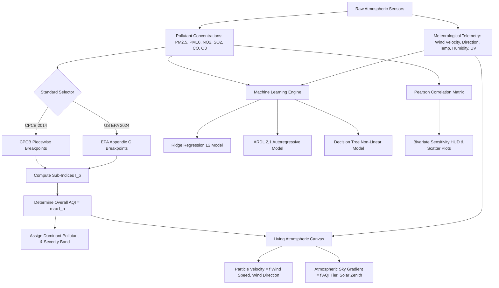

# 🌍 AeroPulse — Dynamic AQI & Atmospheric Research Observatory

[](https://www.typescriptlang.org/)
[](https://react.dev/)
[](https://tailwindcss.com/)
[](https://vitejs.dev/)
[](https://cpcb.nic.in/)
[](LICENSE)

> **AeroPulse** is an institutional-grade atmospheric research observatory and real-time Air Quality Index (AQI) analytics platform. Engineered for environmental scientists, data engineers, and academic researchers, it pairs continuous multi-pollutant empirical telemetry with predictive statistical modeling, interactive geospatial vector flow, and dual international calculation standards (Indian CPCB NAQI and US EPA).

---

## 📑 Table of Contents

- [System Architecture Diagram](#-system-architecture-diagram)
- [Calculation & Analytical Pipeline](#-calculation--analytical-pipeline)
- [Multi-Pollutant Diurnal Dynamics & Visual Curves](#-multi-pollutant-diurnal-dynamics--visual-curves)
  - [24-Hour Multi-Pollutant Diurnal Trajectory](#1-24-hour-multi-pollutant-diurnal-trajectory)
  - [Atmospheric Boundary Layer & Thermal Inversion](#2-atmospheric-boundary-layer--thermal-inversion)
  - [Photochemical Titration & Smog Cycle](#3-photochemical-titration--smog-cycle)
- [Key Features](#-key-features)
- [Scientific & Mathematical Formulations](#-scientific--mathematical-formulations)
  - [CPCB / US EPA Linear Interpolation](#1-piecewise-linear-sub-index-formula)
  - [Breakpoint Reference Thresholds](#2-breakpoint-reference-matrices)
  - [Ridge (L2) & ARDL(2,1) Predictive Modeling](#3-predictive-statistical-modeling)
  - [Bivariate Pearson Correlation Matrix](#4-pearson-correlation-coefficient-r)
- [Living Atmospheric Canvas Engine](#-living-atmospheric-canvas-engine)
- [Tech Stack & Libraries](#-tech-stack--libraries)
- [Project Directory Structure](#-project-directory-structure)
- [Getting Started & Installation](#-getting-started--installation)
- [Academic Defense & Viva Voce Guide](#-academic-defense--viva-voce-guide)
- [License](#-license)

---

## 🏛 System Architecture Diagram

```
+---------------------------------------------------------------------------------------------------------+
|                                         AEROPULSE ARCHITECTURE                                          |
+---------------------------------------------------------------------------------------------------------+
                                                     |
             +---------------------------------------+---------------------------------------+
             |                                                                               |
             v                                                                               v
+-----------------------------+                                               +-----------------------------+
|    TELEMETRY INGESTION      |                                               |     TEMPORAL SCRUBBER       |
|  - Open-Meteo Air Quality   |                                               |  - 120-Hour Continuous Axis |
|  - Real-time GPS Locator    |                                               |  - Past 72h History Ground  |
|  - Curated Urban Nodes (20) |                                               |  - Future 48h Forecast Plume|
+-----------------------------+                                               +-----------------------------+
             |                                                                               |
             +---------------------------------------+---------------------------------------+
                                                     |
                                                     v
+---------------------------------------------------------------------------------------------------------+
|                                    CORE SCIENTIFIC CALCULATION ENGINE                                   |
|                                                                                                         |
|   +------------------------------------+   +------------------------------------+   +---------------+   |
|   |         Indian CPCB Engine         |   |           US EPA Engine            |   | Dominant Poll |   |
|   | - 6 Chemical Breakpoints (2014)    |   | - Revised 40 CFR 58 PM2.5 (2024)   |   |   Extractor   |   |
|   | - Sub-Index: Ip = f(Cp, Blo, Bhi)  |   | - Sub-Index: Ip = f(Cp, Blo, Bhi)  |   | AQI = max(Ip) |   |
|   +------------------------------------+   +------------------------------------+   +---------------+   |
|                                                                                                         |
|   +-------------------------------------------------------------------------------------------------+   |
|   |                              Machine Learning & Statistical Core                                |   |
|   |  - Ridge L2 Regularization (λ ||β||²)               - ARDL(2,1) Autoregressive Time-Lag         |   |
|   |  - Homoscedastic Residual Error Histogram           - Dynamic Counterfactual Scenario Simulator |   |
|   +-------------------------------------------------------------------------------------------------+   |
+---------------------------------------------------------------------------------------------------------+
                                                     |
             +---------------------------------------+---------------------------------------+
             |                                       |                                       |
             v                                       v                                       v
+-------------------------+             +-------------------------+             +-------------------------+
|   REACTIVE UI & HUD     |             |    GEOSPATIAL & GIS     |             |  ATMOSPHERIC CANVAS     |
| - Radial Calibrated Arc |             | - Leaflet Open GIS Tile |             | - 60 FPS Particle Motes |
| - Diurnal Timeline Viz  |             | - Streamline Physics    |             | - Real Wind Vector Flow |
| - 5 Pro Color Themes    |             | - Gemini Flash AI Copil |             | - Diurnal Solar/Stars   |
| - Pearson Corr Matrix   |             | - Spatial Buffer Plume  |             | - Smog Inversion Layer  |
+-------------------------+             +-------------------------+             +-------------------------+
```

---

## 🔄 Calculation & Analytical Pipeline



---

## 📈 Multi-Pollutant Diurnal Dynamics & Visual Curves

### 1. 24-Hour Multi-Pollutant Diurnal Trajectory

Urban atmospheric chemistry exhibits distinct diurnal cycles dictated by solar ultraviolet radiation ($h\nu$), vehicular traffic patterns, and planetary boundary layer ($H_{\text{mix}}$) oscillations. AeroPulse captures these continuous interactions in real-time:

```
  AQI / Concentration (µg/m³)
  400 ┼                                                                                   [Severe]
      │                                                                    # # # # #
  350 ┼                                                                  #           #    <- PM2.5 Surge
      │                                                                #               #
  300 ┼                  * * * *                                     #                   # [Very Poor]
      │                *         *                                 #                       #
  250 ┼              *             *                             #
      │   # # # #   *               *                          #
  200 ┼ #         #*                 *                       #                             [Poor]
      │#          #                   *                    #      * * * * *
  150 ┼          #                     *                 #      *           *          <- AQI (max Ip)
      │         #                       *              #       *             *
  100 ┼        #                         *   o o o o  #       *               *        [Moderate]
      │       #                           * o       o#       *                 *
   50 ┼      #                             o         o      *                   *      [Satisfactory]
      │     #                                                *                     *
    0 ┴─────┴──────────┴──────────┴──────────┴──────────┴──────────┴──────────┴──────────┴─> Hour
     00:00      03:00      06:00      09:00      12:00      15:00      18:00      21:00      24:00
     [Thermal Inversion]   [Morning Rush]   [Solar Noon / O3]   [Evening Rush]   [Night Stagnation]

   LEGEND & CHEMICAL POLARITY:
   # # # #  PM2.5 Aerosol   (Peak: 21:00-04:00 during shallow boundary layer inversion & heating)
   * * * *  Composite AQI   (Governed by max(Ip): PM2.5 in morning/night; O3 during solar noon)
   o o o o  Tropospheric O3 (Photochemical formation peak: 12:00-15:00 via UV titration)
```

#### Diurnal Phase Breakdown

| Time Window | Dominant Mechanism | Boundary Layer ($H_{\text{mix}}$) | Primary Driving Pollutant | Ambient Severity |
| :--- | :--- | :---: | :---: | :---: |
| **00:00 – 06:00** | Radiative surface cooling & calm winds ($<5\text{ km/h}$) trap fine particulates | Shallow ($<150\text{ m}$) | $\text{PM}_{2.5}$ & $\text{PM}_{10}$ | **Very Poor / Severe** |
| **07:00 – 09:00** | Morning vehicular commute & cold-start engine combustion emissions | Expanding ($200\text{--}600\text{ m}$) | $\text{NO}_2$ & $\text{PM}_{2.5}$ | **Poor** |
| **11:00 – 16:00** | Intense solar UV activates photochemical smog; strong convective dilution | Deep ($1500\text{--}2500\text{ m}$) | Tropospheric $\text{O}_3$ | **Moderate / Poor** |
| **17:00 – 20:00** | Evening traffic surge combined with sunset boundary layer collapse | Contracting ($<400\text{ m}$) | $\text{NO}_2$ & $\text{PM}_{2.5}$ | **Poor** |
| **20:00 – 24:00** | Secondary aerosol condensation, biomass heating, and atmospheric stagnation | Trapped ($<100\text{ m}$) | $\text{PM}_{2.5}$ & $\text{CO}$ | **Very Poor / Severe** |

---

### 2. Atmospheric Boundary Layer & Thermal Inversion

The planetary boundary layer controls ground-level dilution volume ($V_{\text{dilution}} = A_{\text{surface}} \times H_{\text{mix}}$):

```
       DAYTIME CONVECTIVE DISPERSION (14:00)           NOCTURNAL RADIATIVE INVERSION (03:00)
       
   Alt (m)                                         Alt (m)
   2000 ^   ☀️ Solar Insolation                     2000 ^
        |   ▲  Warm Convective Plumes                    |   Cold Upper Air Reservoir
   1500 |  / \                                      1500 |   ------------------------------------
        | /   \  (Aerosol Particles Disperse)            |
   1000 |/     \                                    1000 |
        |------- Boundary Layer Cap (H_mix ~1800m)       |
    500 |                                            500 |
        | .   .   .  Low Particle Density                |   ====================================
        |   .   .    Ventilation Coefficient High    150 |   INVERSION CAP: Warm Inversion Layer
      0 +----------------------------------------      0 +===================================
          Ground Surface (Warm, Active Mixing)               Ground Surface (Rapidly Radiated Cold)
          [AQI: Satisfactory to Moderate]                    [AQI: Poor to Severe — Smog Trapped]
```

---

### 3. Photochemical Titration & Smog Cycle

Tropospheric ozone is a secondary pollutant synthesized photochemically from vehicular nitrogen oxides ($\text{NO}_x$) and volatile organic compounds ($\text{VOC}$s) under solar irradiance:

```
                    +---------------------------------------------------+
                    |         VEHICULAR & INDUSTRIAL COMBUSTION         |
                    |              Emissions: NO, NO2, VOCs             |
                    +---------------------------------------------------+
                                         |
                                         v
                     +---------------------------------------+
                     |        Nitrogen Dioxide (NO2)         |
                     +---------------------------------------+
                                         |
                       +-----------------+-----------------+
                       |                                   |
              Daytime Solar Flux (hν)           Nocturnal Ground Chemistry
              (λ < 420 nm Radiation)             (No UV / Solar Inactive)
                       |                                   |
                       v                                   v
         +---------------------------+       +---------------------------+
         | NO2 + hν ---> NO + O(³P)  |       | NO + O3 ---> NO2 + O2     |
         | O(³P) + O2 ---> O3 (Ozone)|       | (Ozone Rapidly Depleted   |
         +---------------------------+       |  via Titration with NO)   |
                       |                     +---------------------------+
                       v                                   |
         +---------------------------+                     v
         | Peak Afternoon Ozone (O3) |       +---------------------------+
         | High Oxidative Potential  |       | Residual Night NO2 & PM   |
         +---------------------------+       +---------------------------+
```

---

## ✨ Key Features

### 1. Dual International Calculation Engine
- **CPCB NAQI (India)**: Evaluates air quality strictly conforming to Indian Central Pollution Control Board (Ministry of Environment, Forest and Climate Change) protocols across 6 severity tiers: *Good, Satisfactory, Moderate, Poor, Very Poor, Severe*.
- **US EPA (United States)**: Evaluates air quality adhering to the revised 2024 EPA National Ambient Air Quality Standards (NAAQS) with updated PM2.5 annual and daily breakpoints across *Good, Moderate, Unhealthy for Sensitive Groups, Unhealthy, Very Unhealthy, Hazardous*.
- **Maximum Operator & Dominant Pollutant**: Identifies the primary health hazard driving ambient toxicity ($AQI = \max(I_p)$) with strict particulate inclusion criteria.

### 2. 120-Hour Continuous Diurnal Scrubber
- Spans **72 hours of validated empirical observations** up to the present moment ($T_0$), combined with **48 hours of predictive meteorological and aerosol dispersion forecasting**.
- Automated detection of **Diurnal Mixing** (daytime planetary boundary layer expansion) vs. **Nocturnal Inversion** (surface cooling confining aerosols to ground breathing zones).
- One-click *Time-lapse playback* and rapid $+3\text{h}$ step forward controls.

### 3. Predictive Data Science & ML Studio
- **Ridge (L2) Regularized Regression**: Solves multicollinearity across particulate matter fractions and vehicular combustion precursors ($\lambda \|\beta\|_2^2$).
- **Autoregressive Distributed Lag (ARDL 2,1)**: Conditions prediction upon lag-1 ($T-1$) and lag-2 ($T-2$) autoregressive states to ensure white-noise residuals.
- **Empirical Diagnostics**: Real-time evaluation of $R^2$ determination, Root Mean Squared Error (RMSE), Mean Absolute Error (MAE), and Mean Absolute Percentage Error (MAPE).
- **Gauss-Markov Verification**: Evaluates residual homoscedasticity and zero-mean distribution.
- **Counterfactual Covariate Simulator**: Sliders allowing researchers to simulate shifts in wind velocity, traffic $\text{NO}_2$, ambient temperature, and relative humidity, projecting the resulting AQI response with a 95% confidence interval.

### 4. Bivariate Pearson Correlation Matrix
- Computes empirical correlation coefficients ($r$) across all pollutant pairs ($N \times N$ matrix).
- Interactive SVG scatter plots with linear trend estimation.
- Grounded atmospheric physics explanations:
  - $\text{PM}_{10}$ vs $\text{PM}_{2.5}$ shared particulate sources ($r \approx +0.85$ to $+0.95$).
  - $\text{NO}_2$ vs $\text{O}_3$ photostationary titration ($\text{NO} + \text{O}_3 \rightarrow \text{NO}_2 + \text{O}_2$, $r \approx -0.40$ to $-0.70$).
  - Wind speed vs aerosol particulate washout/dispersion.

### 5. Interactive GIS Map & Spatial Vector Flow
- High-performance Leaflet mapping with multiple tile layers (Dark Canvas, Street Map, Satellite Imagery, OpenStreetMap).
- Particle canvas overlay visualizing real-time wind streamlines conforming to local wind velocity and direction.
- Plume dispersion buffer visualization and Google Gemini Flash spatial analysis for natural language geographic air quality queries.

### 6. Living Weather & AQI Atmospheric Background
- Hardware-accelerated 60 FPS HTML5 canvas background.
- Aerosol particle simulation representing floating particulates whose count, velocity, and density dynamically match ambient conditions.
- Day/Night cycle rendering solar atmospheric dispersion or nocturnal celestial starfields.
- Dynamic color themes: *AQI Adaptive, Executive Navy, Boreal Forest, Nordic Slate, Sunset Twilight*.

### 7. Academic Viva Voce Hub & RFC 4180 CSV Exporter
- Step-by-step mathematical linear interpolation calculator breaking down $\Delta B$, $\Delta I$, slope, and offsets.
- Complete official breakpoint reference tables.
- One-click RFC 4180 CSV dataset generation containing complete sensor history and meteorological vectors for analysis in Python Pandas or Jupyter Notebooks.
- Curated engineering answers for examination committees.

---

## 🔬 Scientific & Mathematical Formulations

### 1. Piecewise Linear Sub-Index Formula

Both the Indian Central Pollution Control Board (CPCB) and the United States Environmental Protection Agency (US EPA) define air quality sub-indices through piecewise linear interpolation between calibrated concentration breakpoints:

$$I_p = \left[ \frac{I_{hi} - I_{lo}}{B_{hi} - B_{lo}} \right] \times (C_p - B_{lo}) + I_{lo}$$

Where:
- $I_p$ = Calculated sub-index for pollutant $p$
- $C_p$ = Monitored pollutant concentration
- $B_{hi}$ = Breakpoint concentration greater than or equal to $C_p$
- $B_{lo}$ = Breakpoint concentration less than or equal to $C_p$
- $I_{hi}$ = AQI value corresponding to $B_{hi}$
- $I_{lo}$ = AQI value corresponding to $B_{lo}$

The composite Air Quality Index is governed by the maximum sub-index:

$$\text{AQI} = \max(I_{\text{PM2.5}}, I_{\text{PM10}}, I_{\text{NO2}}, I_{\text{SO2}}, I_{\text{CO}}, I_{\text{O3}})$$

---

### 2. Breakpoint Reference Matrices

#### Indian CPCB NAQI Breakpoints (MoEFCC 2014)

| Category | AQI Range | $\text{PM}_{2.5}$ ($\mu\text{g/m}^3$) | $\text{PM}_{10}$ ($\mu\text{g/m}^3$) | $\text{NO}_2$ ($\mu\text{g/m}^3$) | $\text{SO}_2$ ($\mu\text{g/m}^3$) | $\text{CO}$ ($\text{mg/m}^3$) | $\text{O}_3$ ($\mu\text{g/m}^3$) |
| :--- | :---: | :---: | :---: | :---: | :---: | :---: | :---: |
| **Good** | 0 – 50 | 0 – 30 | 0 – 50 | 0 – 40 | 0 – 40 | 0 – 1.0 | 0 – 50 |
| **Satisfactory** | 51 – 100 | 31 – 60 | 51 – 100 | 41 – 80 | 41 – 80 | 1.1 – 2.0 | 51 – 100 |
| **Moderate** | 101 – 200 | 61 – 90 | 101 – 250 | 81 – 180 | 81 – 380 | 2.1 – 10 | 101 – 168 |
| **Poor** | 201 – 300 | 91 – 120 | 251 – 350 | 181 – 280 | 381 – 800 | 10.1 – 17 | 169 – 208 |
| **Very Poor** | 301 – 400 | 121 – 250 | 351 – 430 | 281 – 400 | 801 – 1600 | 17.1 – 34 | 209 – 748 |
| **Severe** | 401 – 500 | 250+ | 430+ | 400+ | 1600+ | 34+ | 748+ |

---

### 3. Predictive Statistical Modeling

#### A. Ridge Regression ($L_2$ Regularization)

To prevent overfitting and stabilize parameter coefficients across collinear features ($\text{PM}_{10}$ and $\text{PM}_{2.5}$):

$$\hat{\beta}_{\text{ridge}} = \arg\min_{\beta} \left\{ \sum_{i=1}^N \left( y_i - \beta_0 - \sum_{j=1}^p x_{ij}\beta_j \right)^2 + \lambda \sum_{j=1}^p \beta_j^2 \right\}$$

Analytical closed-form matrix solution:

$$\hat{\beta} = (X^T X + \lambda I)^{-1} X^T y$$

#### B. Autoregressive Distributed Lag Model — ARDL(2, 1)

Accounts for thermal stagnation and temporal hysteresis across consecutive hourly periods:

$$\text{PM2.5}_t = \alpha + \sum_{i=1}^2 \phi_i \text{PM2.5}_{t-i} + \sum_{k=1}^m \beta_k X_{k, t} + \sum_{k=1}^m \gamma_k X_{k, t-1} + \varepsilon_t$$

Where $X_{k}$ represents meteorological covariates (wind velocity, surface temperature, humidity, and $\text{NO}_2$ combustion precursor).

---

### 4. Pearson Correlation Coefficient ($r$)

Measures linear dependency between two atmospheric telemetry variables $X$ and $Y$:

$$r_{XY} = \frac{\sum_{i=1}^n (X_i - \bar{X})(Y_i - \bar{Y})}{\sqrt{\sum_{i=1}^n (X_i - \bar{X})^2 \sum_{i=1}^n (Y_i - \bar{Y})^2}}$$

---

## 🎨 Living Atmospheric Canvas Engine

```
                      +---------------------------------------+
                      |       METEOROLOGICAL SENSORS          |
                      |   Wind: 18 km/h, Angle: 240 deg       |
                      |   Humidity: 68%, UV Index: 5.4        |
                      +---------------------------------------+
                                          |
                                          v
+-----------------------------------------------------------------------------------+
|                        ATMOSPHERIC CANVAS SIMULATOR                               |
|                                                                                   |
|  *  *  *  (Celestial Starfield if Night / Solar Corona if Daytime)                |
|                                                                                   |
|      ~ ~ ~ ~ ~ ~ > Wind Streamlines (Curved vectors along meteorological angle)   |
|                                                                                   |
|   .   .   o   .   O   .   (Aerosol Micro-Motes: Speed proportional to Wind)       |
|                                                                                   |
|  ======================= (Smog Inversion Horizon: Opacity scaled by AQI)        |
|  ~~~~~~~~~~~~~~~~~~~~~~~ (Breathing Hygroscopic Mist Layer if Humidity > 60%)    |
+-----------------------------------------------------------------------------------+
```

---

## 🛠 Tech Stack & Libraries

- **Frontend Core**: React 19, TypeScript, Vite
- **Styling**: Tailwind CSS v4, Lucide React Icons
- **Mapping & GIS**: Leaflet 1.9.4, ArcGIS & OpenStreetMap Tile Providers
- **Telemetry Data**: Open-Meteo Air Quality & Weather API (Global continuous observations)
- **AI Grounding**: Google Gemini Flash API (`gemini-3.8-flash`) for GIS spatial copilot
- **Mathematics**: Custom linear interpolation, analytical Ridge inversion, Pearson matrix, and Gaussian plume models

---

## 📁 Project Directory Structure

```
.
├── src/
│   ├── components/
│   │   ├── AcademicVivaHub.tsx               # Formula step-through, breakpoints & CSV exporter
│   │   ├── AQIGauge.tsx                      # Calibrated needle arc dial & simulation scrubber
│   │   ├── AtmosphericAmbientBackground.tsx  # Dynamic canvas background with particle physics
│   │   ├── CityComparisonStudio.tsx          # Multi-city cross benchmarking
│   │   ├── ComparativeHeatmapVisual.tsx      # 24-hour comparative diurnal heatmap
│   │   ├── DSMetricSummaryCard.tsx           # ML KPI teaser & top feature beta weights
│   │   ├── HealthAdvisoryCard.tsx            # Clinical & preventive health guidelines
│   │   ├── InteractiveMap.tsx                # Leaflet GIS vector map with Gemini Flash copilot
│   │   ├── MLStudioView.tsx                  # Ridge, ARDL, Decision Tree studio & scenario sliders
│   │   ├── Navbar.tsx                        # 3-Zone top bar, standard toggle, theme switcher
│   │   ├── PearsonCorrelationMatrix.tsx      # Bivariate correlation heatmap & scatter plot
│   │   ├── QuickMetricsRibbon.tsx            # Pollutant concentration cards with safety limits
│   │   ├── StationSearch.tsx                 # Geolocation GPS search & curated stations
│   │   ├── TemporalScrubber.tsx              # 120-hour timeline playback & diurnal indicator
│   │   ├── TrendAnalysisView.tsx             # Multi-pollutant time-series & peak surge analytics
│   │   ├── WeatherAtmosphericCard.tsx        # Meteorological telemetry & dispersion conditions
│   │   └── WindParticleCanvas.tsx            # Wind vector particle physics canvas
│   ├── services/
│   │   ├── airQualityApi.ts                  # Open-Meteo REST API client & station registry
│   │   ├── aqiCalculator.ts                  # CPCB & US EPA piecewise linear interpolation
│   │   └── mlPredictiveEngine.ts             # Ridge L2, ARDL, and counterfactual simulator
│   ├── types/
│   │   └── aqi.ts                            # TypeScript domain models, bands & telemetry types
│   ├── App.tsx                               # Primary root layout & state orchestrator
│   └── main.tsx                              # React DOM entry point
├── public/                                   # Static assets and icons
├── metadata.json                             # AI Studio applet specifications
├── package.json                              # Package dependencies and scripts
└── tsconfig.json                             # TypeScript compiler configuration
```

---

## 🚀 Getting Started & Installation

### Prerequisites

- **Node.js**: v18.0.0 or higher
- **npm**: v9.0.0 or higher

### Local Setup

1. **Clone the repository**:
   ```bash
   git clone https://github.com/kartiksaini/aeropulse.git
   cd aeropulse
   ```

2. **Install dependencies**:
   ```bash
   npm install
   ```

3. **Start the development server**:
   ```bash
   npm run dev
   ```
   Open your browser and navigate to `http://localhost:3000`.

4. **Build for production**:
   ```bash
   npm run build
   ```

---

## 🎓 Academic Defense & Viva Voce Guide

### Q1: How does AeroPulse determine the composite AQI from multiple simultaneous pollutants?
> **Answer**: Under both Central Pollution Control Board (CPCB) and US EPA methodologies, sub-indices ($I_p$) are calculated independently for each measured parameter ($\text{PM}_{2.5}$, $\text{PM}_{10}$, $\text{NO}_2$, $\text{SO}_2$, $\text{CO}$, $\text{O}_3$) using piecewise linear interpolation against standard breakpoint matrices. The overall index corresponds to the maximum sub-index observed ($\text{AQI} = \max(I_p)$). The chemical pollutant corresponding to this maximum value is formally designated as the **Dominant Pollutant**.

### Q2: Why does wind velocity directly correlate with air quality improvements?
> **Answer**: Atmospheric transport and dispersion are governed by horizontal advection and turbulent diffusion (Gaussian plume physics). High wind velocities ($>15\text{ km/h}$) accelerate volumetric dilution and expand the effective ventilation coefficient ($V_c = \text{Mixing Height} \times \text{Wind Speed}$). Conversely, nocturnal calm conditions ($<5\text{ km/h}$) coincide with ground thermal radiative cooling, inducing a temperature inversion cap that traps aerosols in the lower 100 meters.

### Q3: Why use Ridge Regression over Ordinary Least Squares (OLS) for particulate modeling?
> **Answer**: $\text{PM}_{2.5}$ and $\text{PM}_{10}$ exhibit strong collinearity ($r \approx 0.85\text{--}0.95$) due to shared physical sources (combustion and mechanical abrasion). Under standard OLS, the Gram matrix $(X^T X)$ becomes ill-conditioned, inflating parameter variance ($\text{Var}(\hat{\beta}) \propto (X^T X)^{-1}$). Ridge regression introduces an $L_2$ penalty term ($\lambda I$), shifting the eigenvalues and ensuring stable, interpretable standardized beta coefficients.

---

## 📄 License

This project is open-source and released under the [MIT License](LICENSE). Contributions, feedback, and academic citations are welcome!
